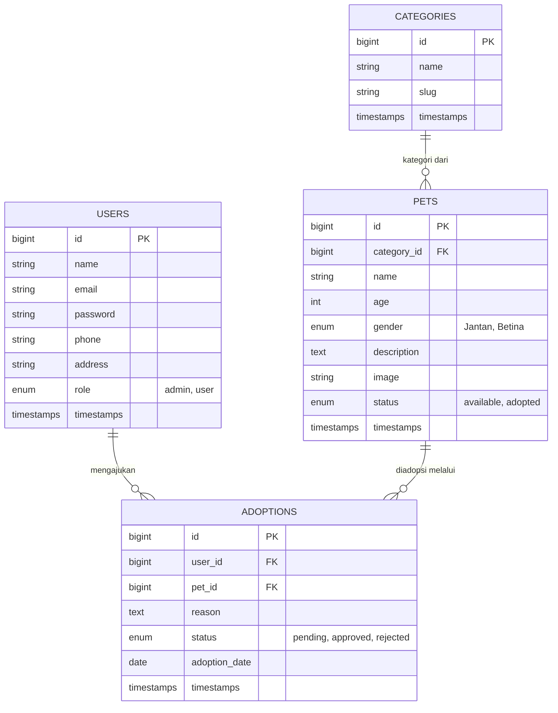

# 🐾 Sistem Adopsi Hewan

Sistem informasi adopsi hewan peliharaan. Pengguna dapat melihat daftar hewan yang tersedia berdasarkan kategori, lalu mengajukan adopsi. Admin mengelola data hewan, kategori, dan memproses pengajuan adopsi.

## 📋 Daftar Isi

- [Fitur](#-fitur)
- [Struktur Database (ERD)](#-struktur-database-erd)
- [Relasi Antar Tabel](#-relasi-antar-tabel)
- [Detail Tabel](#-detail-tabel)
- [Instalasi](#-instalasi)
- [Kontribusi](#-kontribusi)

## ✨ Fitur

Berdasarkan rancangan database, sistem ini mendukung:

- **Manajemen pengguna** dengan dua peran (`admin` dan `user`)
- **Manajemen kategori** hewan (dilengkapi `slug`)
- **Manajemen data hewan** (nama, umur, jenis kelamin, deskripsi, gambar, status)
- **Pengajuan adopsi** oleh pengguna beserta alasan adopsi
- **Status adopsi**: `pending`, `approved`, `rejected`
- **Status hewan**: `available`, `adopted`

## 🗂️ Struktur Database (ERD)



## 🔗 Relasi Antar Tabel

| Relasi | Keterangan | Tipe |
|---|---|---|
| `users` → `adoptions` | Pengguna **mengajukan** adopsi | One to Many |
| `categories` → `pets` | Hewan **berkategori** dari suatu kategori | One to Many |
| `pets` → `adoptions` | Hewan **diadopsi melalui** pengajuan adopsi | One to Many |

## 📑 Detail Tabel

### `users`

| Kolom | Keterangan |
|---|---|
| `id` | Primary Key |
| `name` | Nama pengguna |
| `email` | Email pengguna |
| `password` | Kata sandi |
| `phone` | Nomor telepon |
| `address` | Alamat |
| `role` | `admin` atau `user` |
| `timestamps` | Waktu dibuat & diperbarui |

### `categories`

| Kolom | Keterangan |
|---|---|
| `id` | Primary Key |
| `name` | Nama kategori |
| `slug` | Slug kategori |
| `timestamps` | Waktu dibuat & diperbarui |

### `pets`

| Kolom | Keterangan |
|---|---|
| `id` | Primary Key |
| `category_id` | Foreign Key → `categories.id` |
| `name` | Nama hewan |
| `age` | Umur hewan |
| `gender` | `Jantan` atau `Betina` |
| `description` | Deskripsi hewan |
| `image` | Gambar hewan |
| `status` | `available` atau `adopted` |
| `timestamps` | Waktu dibuat & diperbarui |

### `adoptions`

| Kolom | Keterangan |
|---|---|
| `id` | Primary Key |
| `user_id` | Foreign Key → `users.id` |
| `pet_id` | Foreign Key → `pets.id` |
| `reason` | Alasan mengadopsi |
| `status` | `pending`, `approved`, atau `rejected` |
| `adoption_date` | Tanggal adopsi |
| `timestamps` | Waktu dibuat & diperbarui |

## 🚀 Instalasi

> Sesuaikan langkah di bawah dengan teknologi yang kamu pakai.

```bash
# 1. Clone repository
git clone https://github.com/AdeliaRikaDonita/laravel5d

# 2. Masuk ke folder project
cd laravel5d

# 3. Install dependensi & atur konfigurasi (.env / database)

# 4. Jalankan migrasi database

# 5. Jalankan aplikasi
```

## 🤝 Kontribusi

1. Fork repository ini
2. Buat branch baru (`git checkout -b fitur-baru`)
3. Commit perubahan (`git commit -m "Tambah fitur baru"`)
4. Push ke branch (`git push origin fitur-baru`)
5. Buat Pull Request

## 📄 Lisensi

Tentukan lisensi project kamu di sini (misalnya MIT).